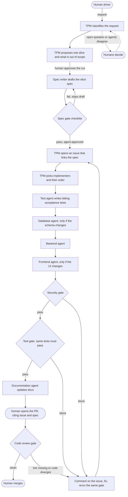

I read the unslop skill, every SKILL.md description in both repos, and the Cursor and Kilo docs on skills and agents. The workflow, roster, skill mapping, and answers below are based on that reading.

## 1. Workflow as I understand it



1. The human driver brings a request to the TPM.
2. The TPM classifies the request as a new feature, a change to an existing spec, a bug, or a docs-only change.
3. The TPM proposes one slice and lists what is out of scope. It doesn't make product decisions. The human approves the cut.
4. The spec writer writes one slice spec with Given/When/Then acceptance criteria. It reads the existing specs, contracts, glossary, and ADRs first.
5. A checklist gate either moves the spec to agent-approved or keeps it in draft. A draft goes back to the spec writer.
6. The TPM opens an issue whose body links the spec path.
7. The TPM picks which implementers the slice needs. The order is Database if the schema changes, then Backend, then Frontend.
8. The test agent turns each acceptance criterion into a failing test. No feature code exists yet.
9. Each implementer builds only what the spec and contracts say, in the order the TPM set.
10. The security agent reviews the diff and can block.
11. The test agent reruns the same tests, unchanged, and can block.
12. The documentation agent updates the docs to match what shipped. Your diagrams don't place this agent, so this position is my proposal.
13. The human opens the PR and cites the issue and the spec path.
14. The code review gate sends the PR back to the implementers if a link is missing or the code differs from the spec.
15. The human merges.

These rules apply at every step:
- A block stays a block. The blocking agent comments on the issue, the owner fixes the problem, and the same gate runs again.
- The TPM never lifts a block or overrides a gate.
- If a question is open or two agents disagree, the TPM escalates to the human. It doesn't invent an answer.
- The TPM runs one slice at a time.

## 2. Agents and roles

| Agent | Tier | Role | Writes to | Can block |
|---|---|---|---|---|
| TPM | Orchestrator | Talks to the human. Classifies requests, proposes cuts, writes a brief for each agent, sets the order, tracks gate results, escalates. Never writes product code. | Issues, status labels, decision log | No |
| Spec writer | Documentation | Writes one slice spec per cut with Given/When/Then criteria. Records new decisions as ADRs and new terms in the glossary. Proposes contract changes. | `docs/features/`, `docs/adr/`, `GLOSSARY.md`, `contracts/` | No |
| Documentation | Documentation | Updates user and developer docs and the changelog after the tests pass. Drafts the PR description for the human. | `docs/` except specs, `README`, `CHANGELOG` | No |
| Database | Implementation | Writes the schema changes and migrations the spec calls for. Runs only when the slice changes the schema. | `db/` | No |
| Backend | Implementation | Writes services and handlers that make the acceptance tests pass, within the API contract. | `server/` and its unit tests | No |
| Frontend | Implementation | Writes the UI for the slice against the API contract. | `web/` and its unit tests | No |
| Security | Gate | Reviews the diff for authentication, authorization, input handling, secrets, data exposure, and dependency risk. | Issue comments, verdict | Yes |
| Test | Gate | Writes failing acceptance tests before implementation. After implementation, confirms the same files pass and are unchanged. | `tests/acceptance/` | Yes |
| Code review | Gate, proposed | Checks the PR against the spec and the repo's standards. | PR review | Yes |

Your diagram has a code-review gate but your list has only two gate agents, so I added it as a proposal. The write scopes are what make the roles enforceable. For example, implementers can't edit acceptance tests and the test agent can't edit product code.

## Open questions

### PRD + ARD, or something else

I'm reading "ARD" as one architecture document. I'd use several small documents plus machine-readable contracts:

| Document | Covers | Lifetime |
|---|---|---|
| Feature brief, a light PRD | One feature: the problem, users, user stories, out of scope | Until the feature ships |
| Slice spec | One slice and one issue: acceptance criteria, contracts touched, test seams, out of scope | Frozen once approved. A change gets a new spec. |
| ADR | One decision: its context, the choice, and the consequences | Permanent, append-only |
| `GLOSSARY.md` | Domain terms shared by specs, code, and tests | Updated as terms change |
| Contracts | OpenAPI file, DB schema, shared types | Versioned with the code |

Reasons:
- The pipeline runs per slice. Gates, tests, and review need a document that covers one slice, and a PRD covers a whole feature.
- One architecture document goes stale because nobody updates it on every change. An ADR records one decision at one date, so it doesn't go stale.
- Each Given/When/Then criterion maps to one acceptance test. That lets the test agent show that every criterion has a test.
- CI can fail a build when code and a contract file disagree. It can't do that with prose.

Matt's `to-spec` template is close to the feature brief. His `to-tickets` produces vertical slices with blocking edges, which matches the cut. Both publish to an issue tracker by default, so you'd adapt them to write files. Give each spec a `status` field in its frontmatter with the values draft, agent-approved, implemented, and superseded.

### Repository structure

I'd keep the factory in its own repo and install it into each product repo with a script. Until then, keep a small sample product inside the factory repo for testing.

```
factory/
├── AGENTS.md             # Cursor and Kilo both load this. Global rules, pointers to agents/ and workflow/
├── agents/               # One canonical definition per agent, not tied to any tool
├── .agents/skills/       # Vendored skills. Cursor reads this path natively
├── workflow/
│   ├── pipeline.md       # States, transitions, which agent may move each one
│   ├── gates/            # One checklist per gate
│   └── templates/        # Brief, slice spec, ADR, issue, block comment, escalation, PR
├── skills.lock.json      # Upstream repo, path, commit SHA, and license for each vendored skill
├── scripts/
│   ├── sync-skills       # Pull a newer upstream SHA and show the diff
│   ├── build-adapters    # Generate .cursor/agents/ and .kilo/agents/ from agents/
│   └── install           # Copy the factory into a product repo
├── ci/                   # Gate checks that run in CI
├── evals/                # Sample product and canned requests for testing the factory
└── docs/adr/             # Decisions about the factory itself
```

```
<product>/
├── AGENTS.md
├── docs/features/<feature>/brief.md
├── docs/features/<feature>/slices/<NN>-<slice>.md
├── docs/adr/
├── docs/GLOSSARY.md
├── contracts/
├── db/
├── server/
├── web/
└── tests/acceptance/
```

The two tools differ in ways that shape this layout:
- Both read `AGENTS.md` at the root.
- [Cursor loads skills](https://cursor.com/help/customization/skills) from `.agents/skills/` and `.cursor/skills/`. [Kilo loads](https://kilo.ai/docs/customize/skills) `.kilo/skills/`, reads `.claude/skills/` as a compatibility path, and accepts `skills.paths` in its config. I couldn't confirm that Kilo reads a project-level `.agents/skills/`. Plan on a `skills.paths` entry or a symlink, and check the result with `kilo debug skill`.
- Each tool stores agent definitions in a different place and format. Cursor uses `.cursor/agents/*.md`. Kilo uses `.kilo/agents/` with its own permission map. That's why `agents/` holds the canonical definitions and a script generates both. Commit the generated files so a fresh clone works, and have CI check that they match.
- [Kilo has no shell-command hooks](https://kilo.ai/articles/claude-code-to-kilo-code-migration-guide), so gate enforcement belongs in git hooks and CI.

### Which agents use which skills

| Agent | Matt Pocock | pstack |
|---|---|---|
| All agents | | `unslop` for anything a human reads, `principle-prove-it-works` |
| TPM | `grilling`, `triage`, `to-tickets`, `wayfinder` for requests too big for one session, `handoff` | `show-me-your-work`, `principle-sequence-verifiable-units`, brief format from the orchestrate playbook |
| Spec writer | `to-spec`, `domain-modeling`, `codebase-design`, `prototype`, `research` | `principle-model-the-domain`, `how` and `why` for existing code |
| Documentation | `writing-for-agents`, `pr` | `technical-writing`, `how` |
| Database | `tdd`, `implement`, `codebase-design` | `principle-make-operations-idempotent`, `principle-type-system-discipline`, `blast-radius` |
| Backend | `tdd`, `implement`, `codebase-design`, `diagnosing-bugs` | `architect`, `principle-boundary-discipline`, `principle-type-system-discipline`, `principle-fix-root-causes`, `typescript-best-practices` if the stack is TypeScript |
| Frontend | `tdd`, `implement`, `prototype` | `architect`, `principle-experience-first`, `typescript-best-practices` if the stack is TypeScript |
| Security | Nothing fits | `blast-radius`, `interrogate`, `principle-boundary-discipline`, plus a security skill you write |
| Test | `tdd` with its `tests.md` and `mocking.md` | `principle-test-behavior-not-implementation`, `create-verification-skill`, pstack's `tdd` for bug-fix slices |
| Code review | `code-review`, whose spec axis checks for divergence from the spec | `interrogate`, `no-comments` |

Only the TPM talks to the human, so the spec writer uses `to-spec`, which writes from existing context without interviewing anyone. It sends its questions back through the TPM.

Reading the skills turned up conflicts and gaps:
1. Matt's `tdd` calls writing all the tests before any implementation an anti-pattern, and your RED step does exactly that. Two loops resolve it. The test agent writes one acceptance test per criterion at the agreed seam. Implementers then run Matt's red-green loop for their own unit tests. Keeping slices small keeps the acceptance suite small, which limits how much the tests guess before code exists.
2. Both repos ship skills named `tdd` and `teach`. Kilo requires a skill's name to match its folder name, so you have to rename one copy of each, for example to `pstack-tdd`.
3. pstack's `tdd` is for bug fixes and tells the agent to skip it unless the user asks. Use Matt's for features.
4. Parts of pstack only work in Cursor. `poteto-mode` calls Cursor's Task tool with cloud environments and uses bun scripts and Graphite. `interrogate` reads its model list from `~/.cursor/rules/pstack-models.mdc`. I'd vendor the principles and standalone skills, adapt `interrogate`, and copy the orchestrate brief format without depending on `poteto-mode`.
5. Some Matt skills assume a different process. `implement` commits to the current branch and runs `code-review` itself, and `to-spec` publishes to a tracker. You'd edit them to follow your pipeline.
6. Most skills, `unslop` included, set `disable-model-invocation: true`. Cursor won't load them automatically, and Kilo ignores the field. To get the same behavior in both tools, each agent file names its skills and tells the agent to read them, and `AGENTS.md` tells every agent to read `unslop` before writing for a human.
7. Neither repo has a security skill. I'd write one based on OWASP ASVS and back it with Semgrep, gitleaks, and a dependency audit in CI.
8. Matt's skills expect `/setup-matt-pocock-skills` to configure the tracker, triage labels, and docs location. Run it once per product repo, or put its answers in `AGENTS.md`.

### Vendor or reference the skills

Copy pinned versions into the repo:
- Both repos change often. Matt's has more than a dozen pending changesets, and pstack is at version 0.15.15. If you reference them live, agent behavior changes without your review.
- Plugin installs only work in one tool each. `/add-plugin pstack` is Cursor-only, and `claude plugins install` is Claude Code-only. Files in the repo work in both Cursor and Kilo.
- You'll be editing them anyway for the reasons above.
- Both repos use the MIT license, so copying is allowed. Keep each LICENSE file next to the vendored skills.

`skills.lock.json` records the source and SHA for each skill and whether you've patched it. `sync-skills` fetches a newer SHA and shows the upstream diff next to your patches before you accept it.

### Other things to consider

- Enforce gates in CI. A prompt rule like "never lift a block" stops working the first time a model ignores it. CI can check that the PR links an issue and a spec, that the spec is agent-approved, that acceptance test files are unchanged between RED and GREEN, and that each agent's commits stay inside its write scope. A commit trailer like `Agent: backend` makes the scope check possible. A `blocked` label plus branch protection stops a blocked PR from merging.
- Keep pipeline state in the tracker and in files, not in chat history. Then any tool can pick up a slice, and the larger company can read the factory's state.
- Run gate agents on a different model family from the implementers. pstack does this so a reviewer doesn't share the blind spots of the model that wrote the code.
- Start every agent with a fresh context and a written brief. The orchestrate brief covers goal, scope, context, acceptance, verification, time limit, forbidden actions, and the report format. Writing these briefs is most of the TPM's job.
- Cap retries. After two failed fixes at the same gate, the TPM escalates to the human.
- Give intake requests and factory deliverables a fixed file format now. Later, a product agent from the larger company can submit work the same way a human does.
- The implementation agents depend on the stack. Pick a default, or make the stack a per-product profile those agents read.
- Turn repeated corrections into rules. Run Matt's `retro` or pstack's `reflect` and `correct` after each slice. They convert repeated corrections into skill edits or lint rules.
- Test the factory itself. Rerun `evals/` after you change any skill or agent file.

## Questions for you

1. Does "ARD" mean an architecture requirements document or architecture decision records? My spec answer assumes the first.
2. Should the factory be its own repo that installs into product repos, or will products live inside this repo?
3. Do you want code review as a third gate agent?
4. Is agent approval enough for a spec, or should the human also sign off on it?
5. What does "the human owns git" mean in practice? May agents create branches and commits, with the human only opening and merging PRs?
6. Which issue tracker: GitHub Issues, Linear, or local markdown?
7. Which stack should the implementation agents assume first?
8. Should the TPM accept requests from other agents from day one, or only from a human for now?
9. Is the documentation agent's position after GREEN right? I gave ADRs and the glossary to the spec writer. Should the documentation agent own them instead?

Once you answer 2, 5, and 6, I can scaffold the repo and write the TPM agent first.
