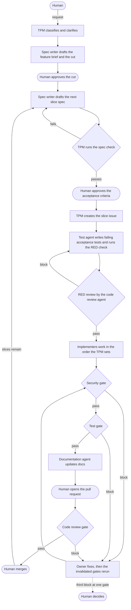

# Pipeline

This file defines how a human request becomes merged code. The TPM runs the pipeline. Every other agent reads the sections for the step it was briefed on.

## Roles

| Role | Does | Agent file |
|---|---|---|
| Human | Makes requests. Approves cuts, acceptance criteria, PRDs, and ARDs. Answers escalations. Opens and merges pull requests. | None |
| TPM | Talks to the human, classifies requests, writes briefs, sets the order of work, changes issue statuses, routes questions, and escalates. Writes no product code. | `chrysalis/agents/tpm.md` |
| Spec writer | Writes PRDs, ARDs, feature briefs, cuts, slice specs, ADRs, and the glossary. Writes for agents. | `chrysalis/agents/spec-writer.md` |
| Documentation | Writes docs for people: guides, the README, the changelog, and PR bodies. | `chrysalis/agents/documentation.md` |
| Database | Writes schema changes and migrations. | `chrysalis/agents/database.md` |
| Backend | Writes server code. | `chrysalis/agents/backend.md` |
| Frontend | Writes UI code. | `chrysalis/agents/frontend.md` |
| Test | Writes failing acceptance tests and runs the RED check before implementation, then runs the test gate. | `chrysalis/agents/test.md` |
| Security | Runs the security gate. | `chrysalis/agents/security.md` |
| Code review | Runs the RED review before implementation and the code review gate after it. | `chrysalis/agents/code-review.md` |
| Factory-maintainer | Changes the factory itself. Takes no part in app work. | `chrysalis/agents/factory-maintainer.md` |

Each agent file sets the agent's write scope. The app's stack profile turns write scopes into file patterns.

## Units of work

- An app is a folder under `apps/`. Its `app.yaml` names its stack, its tracker, and its spec approval mode.
- A request is what the human asks for. A request concerns one app. The TPM splits a request that spans apps into one request per app.
- A feature is new or changed behavior. Its feature brief holds the cut, which lists the slices and what's out of scope.
- A slice is the smallest part of a feature that a user can see working. A slice has one spec, one issue, one branch, and one pull request.
- An issue is the tracker item that holds a unit of work's status and conversation. A feature also gets a request issue, which is the parent of the feature's slice issues.

## Request classes

The TPM classifies every request before work starts. Take the first class that fits.

| Class | Fits when | Path |
|---|---|---|
| Factory change | The request changes `chrysalis/`, a file at the repository root such as `AGENTS.md`, generated tool config, or CI. | Tell the human to start a factory-maintainer session with a message that begins with `factory:`. |
| New app | The app doesn't exist yet. | [App setup](#app-setup) |
| Bug | Current behavior breaks a criterion in an approved spec, a requirement in the ARD, or documented behavior, and the TPM can cite which one. | [Bug](#bug) |
| Docs only | Only documents change. | [Docs only](#docs-only) |
| Small change | Every small-change check below holds. | [Small change](#small-change) |
| Feature | Anything else. | [Feature](#feature) |

A request is a small change when all of these hold:
- It changes no contract, no schema, and no code that handles authentication, permissions, payments, or personal data.
- It changes the backend or the frontend, not both.
- A user would see nothing new beyond text, styling, or configuration. Behavior-preserving refactors and patch-level dependency updates qualify.
- One implementer can finish it in one session.

When the TPM can't cite what a reported bug breaks, the request is a feature or a small change. When the class is unclear, the TPM asks the human.

## App setup

1. The TPM runs `git remote get-url origin`. If `origin` is the public template, `jabarihunt/chrysalis`, the TPM stops and points the human to the README's steps for making a copy, because apps live in copies under [factory ADR 0024](../docs/adr/0024-public-template-and-snapshot-copies.md). The stop has no exceptions. Otherwise the TPM asks the human for the app's name, a one-sentence description, its stack, and its tracker. The defaults are the `jabstack` stack and the `local` tracker. The name can't be `factory`, which [the tracker reserves](tracker.md#the-factory-app) for the factory's own issues.
2. The TPM runs the app setup script. The script creates the `<app>/setup` branch, copies the stack template into `apps/<app>/` without the template's agent instruction files, and writes `app.yaml` with `spec_approval: criteria`.
3. The TPM creates a `setup` issue in the app's tracker with status `approved`.
4. The TPM interviews the human about the product, its users, and its constraints, and records the answers on the issue.
5. The spec writer drafts the PRD and the ARD from the interview notes.
6. The TPM shows the human both documents. The human approves them or asks for changes. The TPM records the approval as a `decision` comment.
7. The work continues at [step 10 of the feature path](#feature), with the security gate. The documentation agent writes the app's README at the docs step.

## Feature

The request issue moves through `intake`, `cut-review`, `in-progress`, and `done`. Each slice issue moves from `approved` to `done` through steps 7 to 16.

1. **Intake.** The TPM creates a request issue with status `intake` and the human's request in their words. It asks questions until it can state the feature in one paragraph, and it records each answer on the issue.
2. **Cut.** The spec writer creates the first slice's branch and drafts the feature brief there. The brief holds the cut, which lists the slices in order, what each one delivers, which slices block which, and what's out of scope. No slice has more than eight acceptance criteria.
3. **Cut approval.** The TPM checks the cut against the request, sets `cut-review`, and shows the cut to the human. The human approves it or asks for changes. The TPM records the approval and sets `in-progress`.
4. **Spec.** The spec writer drafts the next slice's spec on that slice's branch. It posts questions on the request issue. If the feature needs a PRD or ARD change, the spec writer makes it in this slice.
5. **Spec check.** The TPM runs the [spec check](gates.md#spec-check). On a fail, the TPM sends the failed items back to the spec writer.
6. **Criteria approval.** Under `spec_approval: criteria`, the TPM shows the human the [criteria summary](gates.md#criteria-approval). Under `spec_approval: risk-based`, the TPM shows it only when the slice changes a contract, the schema, the PRD, the ARD, or an area the ARD marks security-sensitive. The human approves or asks for changes. The TPM records the approval and the commit SHA of the approved spec.
7. **Issue.** The TPM creates the slice issue with status `approved`. The issue links the request issue, the spec path, the spec SHA, and the branch. The TPM runs the stack's slice-start command if the stack profile defines one.
8. **RED.** The test agent writes one acceptance test per criterion at the seams the spec names. Each test name starts with the slice ID and the criterion ID, as in `[due-dates-01 AC-03]`. The agent runs the [RED check](gates.md#red-check) on its own tests, commits, and reports the commit SHA. The TPM then briefs the code review agent for the [RED review](gates.md#red-review). On a block, the test agent fixes the tests and both run again. On a pass, the TPM records the RED commit SHA and sets `red`.
9. **Implement.** The TPM picks the implementers the spec's layer list names, in the order database, backend, frontend. It sets `implementing` and briefs one implementer at a time. Each implementer writes its own unit tests test-first, commits, and reports. Implementers leave acceptance tests unchanged. The last implementer runs the whole acceptance suite.
10. **Security gate.** The TPM sets `security-review` and briefs the security agent.
11. **Test gate.** The TPM sets `test-review` and briefs the test agent.
12. **Docs.** The TPM sets `docs` and briefs the documentation agent. The agent updates the docs for people and posts the PR body on the issue.
13. **Pull request.** The TPM sets `ready-for-pr` and gives the human the branch name and the PR body. The human opens the pull request.
14. **Code review gate.** The TPM links the pull request with `tracker link --field pr`, sets `code-review`, and briefs the code review agent. In a repository with a remote, the tracker CLI refuses `code-review` until the issue links the pull request. The agent posts its verdict on the pull request, as [the verdict rules](gates.md#verdicts) require.
15. **Merge.** On a pass, the TPM sets `ready-to-merge`. The human merges.
16. **Close.** The TPM sets the slice issue to `done`, runs the stack's slice-end command if one exists, and posts a `retro` comment. The retro names what blocked, what the human corrected, and what an agent got wrong. For a code review block, it links the verdict on the pull request instead of restating the findings. If the cut has slices left, the TPM returns to step 4. After the last slice, it sets the request issue to `done`.

## Small change

1. The TPM creates a `small-change` issue with status `criteria-review`. The body states the change, shows each small-change check holding, and lists acceptance criteria for anything a user could observe.
2. The human approves the criteria, and the TPM sets `approved` and creates the branch. Under `risk-based` approval, the TPM sets `approved` without asking, because a small change touches nothing sensitive by definition.
3. If the issue has acceptance criteria, they go through RED as in step 8 of the feature path, including the RED review. Otherwise the TPM sets `implementing` directly.
4. One implementer makes the change. If the implementer finds the change isn't small, it stops and says so on the issue, and the TPM reclassifies the request as a feature.
5. The work continues at step 10 of the feature path. The docs step runs only if docs for people change.

## Bug

1. The TPM creates a `bug` issue with status `approved` and creates the branch. The body states what happens, what should happen, the criterion or requirement the behavior breaks, and the steps to reproduce. The bug needs no approval, because the human already approved the behavior it breaks.
2. The test agent writes a regression test that fails on the bug. The test name starts with the issue reference and the criterion it protects. The RED check and the RED review run as in step 8 of the feature path.
3. The TPM briefs the implementer for the layer the test agent's report points to. The implementer finds the root cause and fixes it there.
4. If the fix shows that the cited spec is wrong, the implementer stops and says so on the issue. The TPM escalates, and the change becomes a feature with a spec that supersedes the old one.
5. The work continues at step 10 of the feature path.

## Docs only

1. The TPM creates a `docs` issue with status `approved`, states the change and its audience, and creates the branch.
2. The documentation agent writes docs for people. The spec writer writes changes to the PRD, the ARD, the glossary, or ADRs, and the human approves PRD and ARD changes before the pull request.
3. The work continues at step 12 of the feature path. Docs-only work skips the security and test gates.

## Statuses

Only the TPM changes statuses, with one exception. A gate agent sets `blocked` when it blocks, and clears it when it passes on a rerun. For factory issues, the factory-maintainer takes the TPM's part. The tracker CLI enforces these rules, as [the tracker's status rules](tracker.md#status-rules) describe.

| Status | Kinds | Meaning |
|---|---|---|
| `intake` | request | The TPM is classifying the request and asking questions. |
| `cut-review` | request | The cut is waiting for the human's approval. |
| `in-progress` | request | The feature's slices are running. |
| `criteria-review` | small-change | The criteria are waiting for the human's approval. |
| `approved` | setup, slice, small-change, bug, docs, factory | Approved. The first step, such as RED, is under way. A factory issue in this status is agreed work that hasn't started. |
| `red` | slice, small-change, bug | Failing acceptance or regression tests are committed and passed the RED review. |
| `implementing` | slice, small-change, bug, factory | Implementers are working, or the factory-maintainer is. |
| `security-review` | setup, slice, small-change, bug | The security gate is running. |
| `test-review` | setup, slice, small-change, bug | The test gate is running. |
| `docs` | setup, slice, small-change, bug, docs | The documentation agent is working. |
| `ready-for-pr` | all except request | Waiting for the human to open the pull request. |
| `code-review` | all except request | The code review gate is running. |
| `ready-to-merge` | all except request | Waiting for the human to merge. |
| `blocked` | all except request | A gate blocked. The `blocked_by` field names the gate. |
| `needs-human` | all | Escalated. The `prior_status` field holds the status to return to. |
| `done` | all | Finished. |
| `cancelled` | all | Stopped by the human. |

## Human approvals

| Approval | When | The TPM records |
|---|---|---|
| Cut | Feature step 3 | A `decision` comment on the request issue that quotes the human |
| Acceptance criteria | Feature step 6, small-change step 2 | A `decision` comment with the approved spec's commit SHA |
| PRD and ARD | App setup, and any slice or docs-only change to them | A `decision` comment with the commit SHA |
| Escalation answers | Whenever the TPM escalates | A `decision` comment. Lasting decisions also become an ADR. |
| Opening and merging pull requests | Feature steps 13 and 15 | The pull request link, through `tracker link` |

## Briefs, reports, and questions

- The TPM briefs one agent per run with the [agent brief template](../templates/agent-brief.md). The agent starts with a fresh context and sees only the brief and the files it points to, so the brief carries everything the run needs.
- Each run ends with a report in the brief's report format. The TPM posts a summary on the issue as a `report` comment. After a code review run, the comment only links the verdict on the pull request.
- An agent with a question posts a `question` comment that names who should answer. The TPM routes it, either to another agent through a new brief that quotes the question, or to the human. The answer goes on the issue as an `answer` comment.
- Agents reach each other only through the issue and the TPM.
- When two agents disagree, the TPM escalates instead of choosing.

## Gates and blocks

- The RED review runs before implementation. After implementation, the gates run in the order security, test, code review. [The gates file](gates.md) lists what each one checks.
- Each gate posts a verdict that names the commit it checked. The code review gate posts on the pull request, and the other gates post a `verdict` comment on the issue.
- On a block, the gate agent sets `blocked`, fills `blocked_by`, and lists each finding with its fix owner. The TPM briefs the owner with the findings. The status stays `blocked` while the owner works.
- When the fix is in, the TPM briefs the same gate to rerun. Only the gate that blocked can clear the block, and it clears the block by passing.
- A pass covers the commit it names. After a fix, the TPM reruns, in order, every gate whose pass the fix invalidated. [Verdict rules](gates.md#verdicts) define which commits invalidate a pass.
- If a gate blocks a third time on the same issue, the TPM escalates.
- The TPM never lifts a block or skips a gate.

## When a test or a spec is wrong

1. An implementer who believes an acceptance test is wrong posts a `question` on the issue that names the test and the reason. It doesn't edit the test.
2. The TPM briefs the test agent and the spec writer to answer.
3. If the spec is wrong, the spec writer revises it, and the slice returns to the spec check and criteria approval. The test agent then updates the tests, and RED runs again.
4. If only the test is wrong, the test agent fixes it, the RED review runs again, and the TPM records the new RED commit SHA.
5. If they disagree, the TPM escalates.

## Escalation

The TPM escalates when:
- only the human can answer an open question,
- two agents disagree,
- a gate blocks for the third time on one issue,
- a fix shows that an approved spec is wrong,
- a request conflicts with the PRD, the ARD, or an accepted ADR,
- an agent can't finish without writing outside its scope.

To escalate, the TPM saves the current status in `prior_status`, sets `needs-human`, posts an `escalation` comment from the [escalation template](../templates/escalation.md), and asks the human in chat. It records the answer as a `decision` comment, and asks the spec writer for an ADR when the answer is a lasting decision. Then it restores `prior_status`.

## Git

- `master` is the primary branch. Only humans merge into it, through a pull request merged with a merge commit. The `protect-master` ruleset in `.github/rulesets/protect-master.json` enforces this on GitHub, and [factory ADR 0025](../docs/adr/0025-master-takes-merge-commit-pull-requests.md) explains why squash and rebase merges are off.
- Branch names are `<app>/<feature>-<NN>` for slices, `<app>/setup` for app setup, and `<app>/<issue number>-<slug>` for small changes, bugs, and docs-only work. Factory work uses `factory/<issue number>-<slug>`.
- Every commit ends with `Agent:` and `Issue:` trailers.
- Agents never rebase, force-push, open pull requests, or merge. If a branch needs changes from `master`, the TPM asks the human.
- When the repository has a remote, agents push the work branch. Without a remote, the human opens a pull request by telling the TPM the branch is ready for review, and merges it locally. The code review verdict then goes on the issue, because no pull request exists.

## Limits

- A TPM session runs one slice at a time.
- A slice has at most eight acceptance criteria. A slice that needs more goes back to the cut.
- A gate's third block on one issue goes to the human.
- Each brief sets a time or step budget. An agent that runs out stops and reports what it finished.

## Checks

`chrysalis/scripts/check.ts` runs the automated checks listed in [the gates file](gates.md#automated-checks), on demand and in CI. The TPM runs it before setting `ready-for-pr`, and the code review agent runs it on every review.
